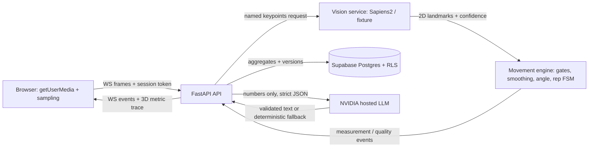

# Backend developer guide — Lennox

Owner: **Lennox** · branch: `feature/lennox` · area: `backend/`, `vision_service/`,
`supabase/`, `fixtures/` · Read first: the blueprint (Sections 6–14) and
`docs/api_contract.md`. Architecture map: `docs/ARCHITECTURE.md`.

## 1. Your role

You build the API, the Sapiens2 vision worker, the deterministic movement
engine, Supabase schema/RLS and the constrained NVIDIA summary. The system must
produce reproducible numbers and reject unreliable input — it must never
fabricate inference or make clinical decisions.

**In scope:** `backend/`, `vision_service/`, `supabase/`, `fixtures/`.
**Out of scope:** the React UI (Steve's).
**You own** the four folders above (CODEOWNERS). Shared files (`docs/`,
`docker-compose*.yml`, `.env.example`, `.github/`, root config) need Steve's
review, and any HTTP/WebSocket contract change needs a PR approved by both of
you; update `docs/api_contract.md` in the same PR. The API verifies role and
patient assignment on the server — the UI is not an authorization layer.

## 2. Architecture and data flow

Three local processes: Vite frontend (:5173), FastAPI API (:8000), FastAPI
vision service (:8001). Supabase stays hosted; NVIDIA is called server-side
only. The vision worker is separate because model imports, CUDA memory and
latency must not destabilize auth/session routes; it can be swapped between
local GPU, remote GPU and labelled fixture mode.



Vision starts first, then API, then frontend (Compose `depends_on` health ordering).

## 3. Folders, conventions, typing and lint

```
backend/app/
├── main.py                 # app, CORS, exception handlers, router
├── api/v1/router.py        # typed endpoints; health real, others 501 stubs
├── core/{config,logging,errors}.py   # pydantic-settings, logging, error contract
├── schemas/{common,session,protocol,summary}.py  # Pydantic request/response types
└── services/{session_service,movement_engine,nvidia_summary,supabase_repository}.py
backend/tests/              # health + Appendix A3 angle tests (passing)
vision_service/app/{main,inference,detector,keypoint_adapter,schemas,config}.py
vision_service/config/keypoint_mapping.yaml    # PLACEHOLDER indices
vision_service/tests/
supabase/migrations/20261124120000_initial_schema.sql
supabase/seed/001_synthetic_demo.sql
fixtures/synthetic_keypoint_sequences/ + approved_test_frames/ (README only)
```

Python 3.12, type hints everywhere (`disallow_untyped_defs` in mypy), Ruff
(`E,F,I,UP,B`, 100 cols) and `ruff format`. All endpoints use Pydantic schemas;
secrets are `SecretStr` in settings and are never logged. `GET /api/v1/health`
is real; other endpoints return `{"detail", "code": "NOT_IMPLEMENTED"}` with 501
and typed response metadata. Implement them one at a time against the contract.

## 4. Running locally

Docker (whole stack, fixture mode, no GPU):
```bash
copy .env.example .env && docker compose up --build
curl localhost:8000/api/v1/health; curl localhost:8001/health
```
Real model: `docker compose -f docker-compose.yml -f docker-compose.gpu.yml up --build`
after the NVIDIA Container Toolkit and the licensed checkpoints are in place.

Without Docker (Python 3.12):
```bash
cd backend && python -m venv .venv && source .venv/bin/activate
pip install -r requirements-dev.txt
uvicorn app.main:app --reload --port 8000
pytest && ruff check . && ruff format --check . && mypy app

cd ../vision_service && python -m venv .venv && source .venv/bin/activate
pip install -r requirements-dev.txt
uvicorn app.main:app --reload --port 8001
pytest && ruff check . && mypy app
```

Environment variables — mark the secrets:

| Variable | Use | Secret? |
|---|---|---|
| `APP_ENV`, `LOG_LEVEL`, `CORS_ORIGINS` | shared config | no |
| `SUPABASE_URL` | backend server-side URL | no |
| `SUPABASE_SERVICE_ROLE_KEY` | backend DB access; bypasses RLS | **YES** |
| `NVIDIA_API_KEY` | backend summary calls | **YES** |
| `NVIDIA_BASE_URL`, `NVIDIA_MODEL_ID` | hosted LLM config | no |
| `STORE_RAW_VIDEO` | default `false`; must stay false | no |
| `MAX_FRAME_RATE`, `SESSION_TOKEN_TTL_SECONDS`, `VISION_SERVICE_URL` | backend limits/routing | no |
| `VISION_MODE` | `fixture` (default) or `sapiens` | no |
| `VISION_DEVICE` | `cpu` / `cuda` | no |
| `SAPIENS_CHECKPOINT_ROOT` | local checkpoint directory (mounted read-only) | no |
| `SAPIENS_POSE_MODEL`, `SAPIENS_DETECTOR_MODEL` | model IDs, env-configured | no |

Never commit `.env` or secrets; CI must pass with no repository secrets.

## 5. Authorization per endpoint

The table in `docs/api_contract.md` is authoritative — do not duplicate it here.
In short: patients see only their own protocols/sessions/metrics/summaries;
clinicians see only patients with an active `clinician_patient_links` row; only
assigned clinicians create/version protocols; WebSocket uses a short-lived
session token bound to user + session; unauthenticated requests get 401,
unauthorized 403, invisible resources 404. Enforce in the API and in RLS.

## 6. Movement engine (blueprint Section 7, Appendix A3)

Implemented in `backend/app/services/movement_engine.py`:

1. **Landmark validation** — require named `selected_hip/knee/ankle` above a
   configurable confidence threshold before any filtering. Never smooth an
   invalid keypoint into a plausible-looking measurement.
2. **Projected angle** — `projected_joint_angle(a,b,c)` = `arccos(clip(dot(u,v)/(|u||v|),-1,1))`
   in degrees, with `u = hip-knee`, `v = ankle-knee`; returns `None` for
   zero-length vectors. It is a 2D projected estimate, not anatomical.
3. **Smoothing** — exponential moving average with configurable alpha;
   timestamp-based (not frame-count) tempo; pause the state machine past a
   configured gap instead of interpolating across occlusions.
4. **Repetition state machine** — `REST → EXTENDING → TARGET_HOLD → RETURNING`,
   incrementing one rep only on a valid return; `INVALID`/`PAUSED` on low
   confidence, person loss or user pause counts nothing. Thresholds come from
   clinician-configured protocol parameters — there is no universal threshold.
5. **Quality rejection** — person visibility, landmark confidence, continuity,
   side view, temporal completeness and model/mapping version checks. Keep
   measurement quality separate from clinical performance; a low-quality
   session shows "insufficient data", not a red/green judgement.

Unit tests cover known geometry (90°, 180°, degenerate) and scripted rep traces.
These validate math only, not Sapiens2 accuracy. Next: signal tests with noise,
missing frames, out-of-order timestamps and occlusions.

## 7. Supabase

- Migrations are timestamped SQL in `supabase/migrations/`; apply with the
  Supabase MCP `apply_migration` or `supabase db push`. Never edit an applied
  migration — add a new one. After applying, run the security and performance
  advisors and fix RLS findings in a new migration.
- RLS is enabled on every exposed table. Policy pattern: patient reads own rows;
  assigned clinician reads linked patients via `clinician_link_active()`;
  derived tables (metrics, rep events, flags, summaries, audit) are readable
  through the parent session but written only by the service role. Roles come
  from application-managed profile data set by the trusted backend, not from
  user-editable auth metadata.
- Test the RLS matrix (patient A, patient B, assigned clinician, unassigned
  clinician, anonymous) for zero cross-patient reads before any non-synthetic data.
- `supabase/seed/001_synthetic_demo.sql` is **synthetic only** — fake UUIDs and
  `example.invalid` emails. Never insert real patient data. Keep the service-role
  key on the backend only; never in the frontend or a Vite variable. Private
  storage only if an approved asset is needed; no public patient bucket.

### Supabase MCP (Hermes Agent)

Generic steps, no credentials in docs: configure the remote MCP server in your
agent (`hermes mcp add supabase --url "<project MCP URL>" --auth oauth`, then
`hermes mcp login supabase --flow browser`), approve the browser OAuth once, and
confirm with `hermes mcp list` / `hermes mcp test supabase`. Then list tools,
apply each migration, run the security/performance advisors, and verify RLS
with synthetic accounts. Never paste an access token or service-role key into
the repo or chat. If the connection is not authenticated, skip the migration
and report it — do not work around the login.

## 8. NVIDIA integration (blueprint Section 9)

- Input is a **minimised, de-identified numeric metrics object only** — never
  frames, identifiers or raw keypoints. Base URL and model ID come from env;
  the exact model is pinned only after a key test in the API Catalog.
- Allowed: explain measured values in neutral language, describe each field,
  draft a clinician note repeating measured values and missing data.
  Disallowed: diagnosis, recovery/safety claims, new exercises or target
  changes, invented values, low-confidence → confident statements.
- Strict JSON schema (`headline`, `what_was_measured`, `observed_values`,
  `data_quality_note`, `clinician_review_note`). `validate_summary()` rejects
  disallowed claims and any invented number; the UI renders canonical stored
  numbers, not LLM-copied values. If the API times out, returns bad JSON or an
  unsupported claim, return `deterministic_summary()`. Store the provider,
  model id and schema version with the summary.

## 9. Sapiens2, fixtures and the licence gate

- Sapiens2 Pose 0.4B is the engineering target; Sapiens2 terms restrict
  biometric processing and unlicensed medical practice. **License review is a
  go/no-go gate** before identifiable or patient-facing use. No bypass.
- `vision_service/config/keypoint_mapping.yaml` is a **placeholder**: all
  Sociopticon indices are `null` on purpose. Do not guess indices. Resolve them
  from the official keypoint spec, pin and review them, then the adapter will
  allow `sapiens` mode. Until then `sapiens` fails with
  `vision service unavailable` (HTTP 503).
- `VISION_MODE=fixture` (default) replays labelled synthetic keypoints. Every
  response has `simulated: true` and `model: fixture-simulated`. Never present
  it as real inference. Fixtures live in `fixtures/synthetic_keypoint_sequences/`;
  `fixtures/approved_test_frames/` stays empty in Git.
- Smoke test: see `docs/model-smoke-test.md` — record model id, checkpoint hash,
  detector, driver/GPU, image size and inference time; report pose quality
  separately from engine math accuracy and end-to-end reliability.

## 10. Privacy, safety and Kenya context (blueprint Section 13)

- `STORE_RAW_VIDEO=false` by default; frames are transient, buffers cleared
  after inference; no video recording endpoint. No raw frames to third parties
  (including NVIDIA) — only numbers. No diagnosis or treatment advice anywhere.
- Kenya's Data Protection Act 2019 s.46 restricts health-data processing to
  responsible healthcare providers / professionals bound by secrecy. ODPC
  guidance covers health data, storage limitation, DPIAs and treats biometric
  data as sensitive. Removing names does not make footage anonymous. Obtain
  legal advice on controller/processor roles, complete a DPIA determination,
  document consent/retention/incident processes, and clear the Sapiens2 licence
  **before** any real-patient pilot. Competition demos use synthetic or
  explicitly approved data only.

## 11. Testing strategy

- Geometry unit tests (done), signal tests (noise/gaps/out-of-order), rep-counter
  tests (full, partial, false start, pause, low confidence).
- API tests for auth, state transitions, invalid payloads and dependency
  failures; vision tests in fixture mode only, no GPU/weights.
- RLS tests for the full role matrix; check raw-video retention is zero; check
  NVIDIA numeric consistency and the key-removed fallback.
- CI runs ruff/format/mypy/pytest for both Python services with no secrets.

## 12. Git, PRs and definition of done

Work on `feature/lennox`, PR into `develop`; Steve reviews shared files and
anything contract-related. Never push to `main`/`develop`. See
`docs/GIT_WORKFLOW.md` for full rules and branch protection settings.

PR checklist: lint/typecheck/tests green; docs and contract updated if needed;
both owners approved for shared/contract changes; no secrets, weights or
patient data; safety review; "does this change the API contract?" answered.

Done means it runs from a clean checkout, has passing checks, is documented,
reviewed and merged into `develop`.

## 13. Glossary

- **Landmark** — named 2D keypoint (`selected_hip/knee/ankle`) in image space.
- **Projected angle** — angle at the knee in the image plane; an estimate.
- **Quality gate** — validation rule that rejects unusable frames.
- **Rep FSM** — deterministic repetition state machine.
- **Fixtures** — labelled synthetic test data, always marked simulated.
- **RLS / service role** — row-level authorization / backend-only DB credential.

## 14. Known limitations

2D projected angles only; no clinical validation or real-time guarantee;
Sapiens2 licence unresolved; `sapiens` mode cannot run until weights and real
keypoint indices are supplied; the geometry tests validate math, not model
accuracy; most API endpoints are 501 stubs in the scaffold; no real patient data
is permitted. The blueprint's media folder was absent from the repo, so example
screenshots are not bundled.

## 15. First tasks for Lennox (blueprint Section 15, 0–16h)

0–8 h:
1. **Sapiens2 smoke test first** — check the licence gate, install the licensed
   package, download the 0.4B pose checkpoint + DETR detector, run the official
   demo on approved frames, record load/inference time and model version. If
   blocked, record the decision to use labelled synthetic keypoints — never
   fake inference.
2. FastAPI project, Supabase project/schema draft and environment loader;
   agree JSON contracts with Steve.

8–16 h:
3. Vision service `/infer`, output parser and named lower-body landmark adapter
   (resolve mapping placeholders from the official spec; reject otherwise).
4. Reach the first frame → Sapiens2 → named keypoint round trip, then move on to
   angle calculation and rep state-machine tests.

See `docs/ARCHITECTURE.md` for the system boundaries.
